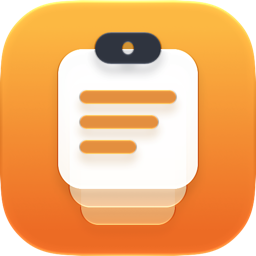

<p align="center">
  
</p>

<h1 align="center">Clipboard</h1>

<p align="center">
  <strong>A clipboard history for iOS that keeps watching while you work in other apps.</strong>
</p>

<p align="center">
  <code>iOS 27.2+</code> &bull;
  <code>History stays on device</code> &bull;
  <code>16 Copy As transforms</code>
</p>

<p align="center">
  <a href="UNLICENSE">
    
  </a>
  <a href="https://www.buymeacoffee.com/oliverames">
    
  </a>
</p>

---

Clipboard keeps a searchable history of what you copy: text, rich text, images, links, and code. It keeps watching the clipboard while you use other apps, so a copy you made a minute ago is still there. The history lives on your iPhone, and the layout accounts for the outer display of iPhone Duo.

## Why this exists

The iOS clipboard holds one item. Each new copy replaces the last, and iOS offers no public way for an app to keep a history in the background. Most clipboard managers work around this by asking you to open them first, so they miss the copies you made in the moment.

Clipboard is built on [Clip](https://github.com/rileytestut/Clip), Riley Testut's clipboard manager. Clip keeps monitoring in the background by relying on undocumented system interfaces, so it can't pass App Review and it was never distributed through the App Store. This repository is my version, built for my own iPhone, with the features I use every day: favorites and pins, lists, search, code detection, transforms, and Shortcuts.

## Features

### Capture
- Saves text, rich text, images, links, and code copied in other apps.
- Tags each clipping with where you copied it, when you allow Always location access.
- Detects code snippets so you can filter for them.
- Shows link previews, including the App Store icon for a site's app. Previews are cached on disk, so they're only fetched once.

### Organize
- **Favorites and pins.** Mark clippings as favorites to find them in one place. Pinned clippings stay at the top of the history.
- **Lists.** Group related clippings into named lists.
- **Filters.** Show only text, rich text, images, links, or code.
- **Search.** Fuzzy search finds clippings whose characters appear in order in your query, ignoring case and accents.
- **Trash.** Deleted clippings move to Trash. Restore them, or empty Trash when you're done.
- **Map.** See clippings that have a location on a map.

### Use
- **Copy As.** Copy a clipping after a transform: UPPERCASE, lowercase, Title Case, camelCase, snake_case, kebab-case, Pretty JSON, Minified JSON, URL Encode, URL Decode, Base64 Encode, Base64 Decode, Strip Markdown, Trim Whitespace, Sort Lines, and Remove Duplicate Lines.
- **Keyboard.** A keyboard extension lists recent clippings. Pick one to copy it back to the clipboard, then paste it into any app.
- **Shortcuts.** Save Clipboard saves the current clipboard. Get Latest Clipping returns the newest text clipping. The second action is off until you turn on Allow Shortcuts Access, and it requires an unlocked device.
- **Settings.** Choose how many clippings to keep, and turn link previews on or off.

## How capture works

Clipboard relies on three things to stay current.

1. **Always location access** keeps Clipboard running in the background. Clipboard uses your location only to tag clippings.
2. **A direct read.** When the clipboard changes while Clipboard is open, it reads the new copy through the private `Pasteboard.framework` interface and saves it. Opening the app also pulls down whatever is in the clipboard at that moment.
3. **A widget extension.** iOS won't hand the general clipboard to an app that's in the background, so Clipboard asks a widget extension to read it. The system starts the widget's process on demand, so the copy saves on its own, with no notification and nothing to tap.

Copies you make from within Clipboard are ignored. The iOS Simulator doesn't run background monitoring, so test capture on a physical device.

### Why a widget is required

iOS withholds the general clipboard from apps in the background, and there is no public way around it. The rule is enforced by the pasteboard daemon: it reads the client's code signature and grants background access only to clients carrying the private entitlement `com.apple.Pasteboard.background-access`, to Apple-signed clients, and to app extensions, which it recognises through Launch Services.

An app extension qualifies, and a widget is the one the system will start on demand without a notification being involved. `WidgetCenter.reloadTimelines` makes the system launch the widget's process, which reads the clipboard and writes the clipping to the shared store.

The entitlement itself can't be used here: Xcode refuses to build it, and the phone rejects an app whose signature contains an entitlement its provisioning profile doesn't cover. Neither does a configuration profile, a silent audio session, nor claiming to own the clipboard's data. The full write-up, with the decompiled decision logic and everything that was ruled out, is in [docs/ios-pasteboard-background-access.md](docs/ios-pasteboard-background-access.md).

## Setup

Install Clipboard on your iPhone (see [Building from source](#building-from-source)), then open it and follow the onboarding steps:

1. **Allow paste access.** Go to Settings, then Privacy & Security, then Paste from Other Apps, then Clipboard, and choose Allow. The option appears after Clipboard reads the clipboard once.
2. **Keep monitoring in the background.** Go to Settings, then Clipboard, then Location, and choose Always.
3. **Optional: Shortcuts access.** In Clipboard's settings, turn on Allow Shortcuts Access.

### Adding the widget

Background capture runs in a widget extension, because that is the only kind of process
iOS will start on demand and hand the general clipboard to. The system starts it
whether or not the widget is on a home screen, but WidgetKit refreshes a widget that
is actually on a home screen far more eagerly, and it shows your clipping count while
it's there.

Long-press a home screen, tap **Edit**, then **Add Widget**, and pick **Clipboard**.

## Privacy

- Clipboard history stays on your device, in an App Group container shared by the app and its extensions.
- Clipboard has no accounts, no sync, and no analytics.
- Location is used only to tag clippings. It is never sent off the device.
- Link previews contact the page you copied. For App Store icons, Clipboard searches Apple's iTunes Search API for the site's brand name, such as "github", and downloads the icon. Turn off link previews in Settings to stop these requests.

## Building from source

**Requirements**

- Xcode 27.2 or later
- An iPhone running iOS 27.2 or later
- An Apple developer team for code signing

**Steps**

```bash
git clone --recurse-submodules https://github.com/oliverames/clipboard.git
cd clipboard
open Clipboard.xcodeproj
```

The Roxas submodule still targets iOS 10.0, which Xcode 27.2 rejects. Before you build, raise its deployment target to 16.0:

```bash
sed -i '' 's/IPHONEOS_DEPLOYMENT_TARGET = 10.0;/IPHONEOS_DEPLOYMENT_TARGET = 16.0;/' Dependencies/Roxas/Roxas.xcodeproj/project.pbxproj
```

Then, in Xcode:

1. Set your development team for the Clipboard, ClipboardKeyboard, ClipboardReader, and ClipboardKit targets.
2. Replace the bundle identifier prefix `com.oliverames.clipboard` with one you own. Replace `group.com.oliverames.clipboard` in the `.entitlements` files and `Info.plist` files to match. All targets must share the same App Group.
3. Run the Clipboard scheme on a physical iPhone.

## Architecture

| Target | Role |
|--------|------|
| `Clipboard` | The app: history, clipping detail, settings, onboarding, map, Shortcuts intents, and pasteboard monitoring |
| `ClipboardKeyboard` | Keyboard extension that lists recent clippings |
| `ClipboardReader` | Notification service extension that saves a copy taken while the app is in the background |
| `ClipboardKit` | Shared framework: the Core Data model, code detection, fuzzy search, transforms, link previews, and SwiftUI keyboard views |
| `Dependencies/Roxas` | Utility framework, included as a Git submodule |

The Core Data model has three entities. `PasteboardItem` holds each clipping, with its favorite, pin, and trash state. `PasteboardItemRepresentation` holds each format a clipping was copied in. `ClippingList` groups clippings into named lists.

## Status

Everything listed under Features is implemented. Background capture is handled by the notification service extension, and foreground capture by a direct read through the private `Pasteboard.framework` interface. Both are verified on a physical iPhone.

**Planned:** iCloud sync. It needs an iCloud container and a Core Data model that CloudKit can sync. Clipboard doesn't sync between devices yet.

## Credits and license

Clipboard is based on [Clip](https://github.com/rileytestut/Clip) by Riley Testut. Both projects are released under [The Unlicense](UNLICENSE), which places the work in the public domain.

---

<p align="center">
  <a href="https://www.buymeacoffee.com/oliverames">
    
  </a>
</p>

<p align="center">
  <sub>
    Built by <a href="https://ames.consulting">Oliver Ames</a> in Vermont
    &bull; <a href="https://github.com/oliverames">GitHub</a>
    &bull; <a href="https://linkedin.com/in/oliverames">LinkedIn</a>
    &bull; <a href="https://bsky.app/profile/oliverames.bsky.social">Bluesky</a>
  </sub>
</p>
